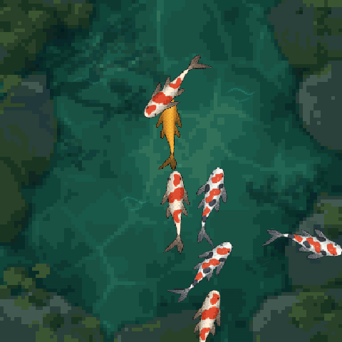

# ESP-Mosaico 像素鱼缸

这是一个运行在 ESP-Mosaico（ESP32-S31）上的桌面像素鱼塘。Pixel Koi 1.3.0 原生固件在 480×480 屏幕上绘制俯视鱼塘，八条锦鲤各自巡游、减速休息，也会在轻点屏幕后游来抢食。鱼塘可以在晴天和雨天之间切换。



上图是使用原生场景代码生成的离屏预览。[查看真机投食视频（静音）](docs/media/device-feeding.mp4)。

## 下载与安装

下载 [v1.3.0 完整分享包](https://github.com/hicworld/esp-mosaico-pixel-aquarium/releases/download/v1.3.0/Pixel-Koi-1.3.0_ESP-Mosaico.zip)，或进入 [版本发布页](https://github.com/hicworld/esp-mosaico-pixel-aquarium/releases/tag/v1.3.0) 查看校验文件与说明。

分享包包含预编译固件、Windows 烧录工具、原生源码、场景预览和外壳 STL。需要 ESP-Mosaico／ESP32-S31、原装 480×480 触摸屏、扬声器与 16 MB 内部 Flash。电脑安装 64 位 Python 3.11 后，完整解压 ZIP，阅读“先读我.md”，再打开 `firmware` 文件夹中的 `烧录固件.cmd`。首次运行会联网安装烧录工具。

**分享包默认使用独立启动方式，烧录会覆盖 ota_0 中的应用平台并重设启动选择。** 设备开机直接进入鱼塘，恢复原平台需要再次烧录相应平台固件。这套独立安装流程已完成文件与脚本检查，仍待重新实机验证。下文的历史真机测量来自鱼塘运行于 ota_1、保留 ota_0 平台的安装方式。

安装器源码位于 [installer](installer/)，实际烧录使用完整分享包中的固件与工具。项目整体尚未指定开源许可证，第三方许可文件随源码保留。

## 操作

| 操作 | 效果 |
| --- | --- |
| 开机 | 进入晴天鱼塘 |
| 轻点水面 | 在指尖附近随机撒下 3～6 粒鱼食 |
| 左滑或右滑 | 切换晴天和雨天 |
| 上滑或下滑 | 调整环境音量，每次 10 格，降到 0 即静音 |

晴天有树影和水面波光，雨滴落下会留下逐渐散开的涟漪。两个场景各自循环播放一段环境音。部分锦鲤的巡游路线会经过屏幕外，投食时也能游回来。

## 动画和显示

- **鱼群行为**　每 50 ms 推进一次模拟。鱼沿各自的路点巡游，转向和加减速分多步完成。鱼休息时会滑行减速，停稳后尾巴仍轻轻摆动。几条鱼在同一步内接触同一粒鱼食时，用步首和步末的鱼嘴距离估算到达先后。
- **绘制**　显示前在相邻模拟状态之间插值，补出中间位置和朝向。把变化区域合成到 480×480 的 RGB565 画布上，再由 LVGL 局部刷新。
- **真机测量**　1.3.0 在晴天巡游时，三次串口短测分别读到 59、60、60 fps。计数表示屏幕每秒完成的更新批次，单批更新可包含多个局部区域。

| 路径 | 内容 |
| --- | --- |
| [`animation/native-pond/`](animation/native-pond/) | 原生固件、构建与安装脚本、离屏预览和验证 |
| [`installer/`](installer/) | 分享包使用的独立烧录工具源码 |
| [`animation/pixel-fish/`](animation/pixel-fish/) | 共享的绘制代码、鱼体姿态素材和早期三鱼 WASM 应用源码 |
| [`animation/firmware-60hz/`](animation/firmware-60hz/) | 早期应用平台刷新方案的四份历史补丁 |
| [`model.py`](model.py)、[`STL/`](STL/) | 外壳的 CadQuery 源码及打印件 |

## 构建原生固件

准备 Windows PowerShell、Python 和启用了 ESP32-S31 工具链的 ESP-IDF 6.1。仓库已包含该版本使用的 ESP-Mosaico BSP、CO5300 驱动、修改版 LVGL adapter 和两段环境音。首次构建会由 ESP-IDF 组件管理器联网获取其余依赖。

在仓库根目录运行，参数替换为本机路径。构建目录应为单独的 ASCII 路径。

```powershell
.\animation\native-pond\build.ps1 `
  -BuildRoot 'C:\esp\koi-pond-build' `
  -EspEnvironment 'C:\path\to\esp-idf-6.1-profile.ps1'
```

已激活 ESP-IDF 6.1 环境时可省略 `-EspEnvironment`。构建产物位于 `animation/dist/pixel-koi-pond-1.3.0.bin`。接收者也可以按[音频说明](animation/native-pond/main/assets/来源.md)替换为自己的两段 24 kHz 单声道 MP3。

### 保留原平台的历史安装方式

安装器面向已验证的 Mosaico 0.5.3 双 OTA 布局。运行前准备 USB 数据线、ESP-IDF 的 Python 环境和当前设备 `ota_0` 对应的 0.5.3 应用镜像。安装器会校验该镜像与设备上 `ota_0` 的内容一致，并在 Windows 的 `C:/esp` 下保存恢复文件，运行前请确保该目录已存在。以下命令从仓库根目录运行，Python 路径和平台镜像路径替换为本机实际值。

```powershell
& 'C:\path\to\esp-idf-python\python.exe' .\animation\native-pond\install.py `
  --image .\animation\dist\pixel-koi-pond-1.3.0.bin `
  --platform-image 'C:\path\to\mosaico-platform-0.5.3.bin'
```

安装后鱼塘运行在 `ota_1`，原应用平台保留在 `ota_0`。USB 串口输入 `status` 可查看场景和启动分区，`audio_status` 可查看音频状态，`pond_fps` 可查看屏幕更新计数。输入 `restore` 会重启并回到原应用平台。详见[原生固件使用说明](animation/native-pond/使用说明.md)。

### 离屏预览

在装有 WASI SDK 34、Node.js 和 FFmpeg 的电脑上，从仓库根目录运行。预览用 WASM 执行同一份场景代码，可在无设备的情况下检查投食、天气手势、八条鱼入画以及局部重绘。

```powershell
.\animation\native-pond\preview.ps1 -WasiSdk 'C:\path\to\wasi-sdk'
```

预览输出为 `animation/dist/pixel-koi-sunny-rain.gif`。

## 外壳设计

[CAD 预览](preview.png)展示了带抽拉托盘的外壳和用于固定透明片的 45° 导槽。打印件和透明片尺寸见[装配说明](装配说明.md)。其中的黑底倒影和校准步骤对应早期 WASM 应用，操作方式见[早期应用说明](animation/使用说明.md)。

## 许可证

项目代码目前未指定开源许可证。随原生固件源码附带的第三方库 minimp3 使用 CC0 1.0，见 [minimp3 LICENSE](animation/native-pond/main/third_party/minimp3/LICENSE)。BSP、CO5300 驱动与 LVGL adapter 的许可证保留在 [components](animation/native-pond/components/) 中。
